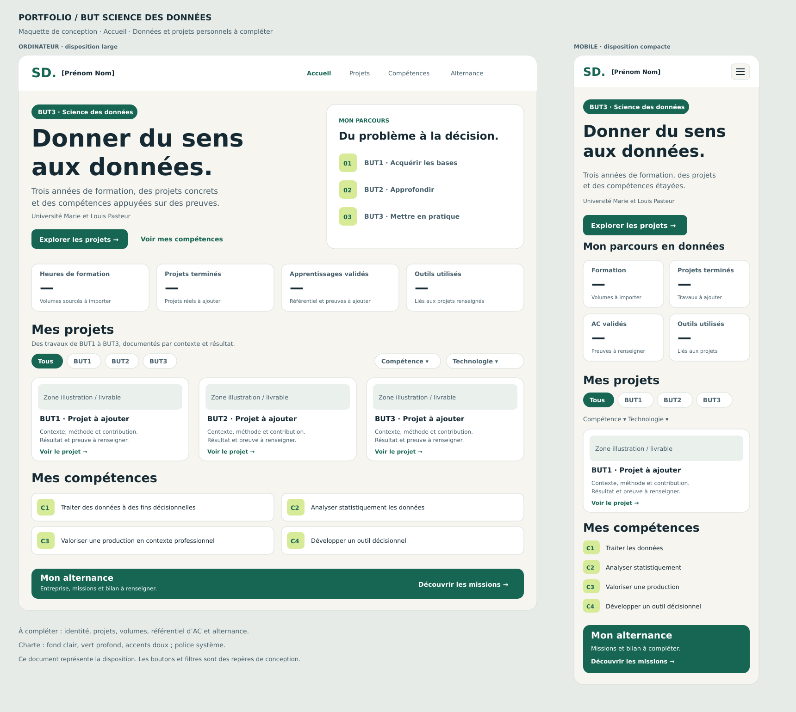

# Mes projets — Portfolio BUT Science des données

Portfolio de trois années de BUT Science des données à l’Université Marie et Louis Pasteur. Le site présentera les projets, les compétences C1 à C4, les outils techniques, l’alternance et des indicateurs calculés à partir des données renseignées.

**État au 14 octobre 2026 : kit de conception, de données et de gestion de projet. Le serveur et le site fonctionnel restent à développer.** Ce dépôt contient les documents préparatoires, les maquettes et les scripts PostgreSQL. Les projets réels, les heures de formation et les apprentissages acquis restent à renseigner.

Dépôt : [ADLIB-Mrani/Mes-projets](https://github.com/ADLIB-Mrani/Mes-projets).

## Objectif

Donner à un recruteur ou à une formation une vue claire du parcours : pour chaque projet, expliquer le problème, les méthodes, la contribution personnelle, le résultat et les preuves. Respecter les exigences pédagogiques de planning, de maquette préalable, de commits réguliers et de documentation.

## Fonctionnalités prévues

- **Accueil** : présentation du parcours, sélection de projets et statistiques globales.
- **Projets** : liste filtrable par semestre, compétence et outil ; fiche détaillée avec résultats et preuves.
- **Compétences** : C1 à C4, outils techniques et apprentissages critiques documentés.
- **Alternance** : missions, contributions et bilan professionnel.
- **Statistiques** : heures de formation, répartition par compétence et nombre de projets publiés, calculés à partir de données sourcées.
- **Affichage responsive** : navigation utilisable sur ordinateur et téléphone.

| Compétence | Intitulé |
| --- | --- |
| C1 | Traiter des données à des fins décisionnelles |
| C2 | Analyser statistiquement les données |
| C3 | Valoriser une production dans un contexte professionnel |
| C4 | Développer un outil décisionnel |

## Aperçu de la maquette



La maquette représente l’interface proposée. Elle ne constitue pas encore un site fonctionnel.

## Documents disponibles

- [Outils recommandés](docs/OUTILS.md) et bénéfices utiles du Student Developer Pack.
- [Planning](docs/PLANNING.md), séances encadrées et [Gantt prévisionnel en PNG](docs/gantt.png).
- [Maquette ordinateur et mobile](docs/maquettes/portfolio.svg), également disponible [en PNG](docs/maquettes/portfolio.png).
- [Charte graphique](docs/CHARTE.md) et [contenu des pages](docs/CONTENU.md).
- [Architecture et relations PostgreSQL](docs/ARCHITECTURE.md).
- [Organisation GitHub](docs/GITHUB.md) et [tâches à créer](docs/ISSUES.md).
- [Journal d’avancement](AVANCEMENT.md) à maintenir pendant le projet.
- Scripts SQL dans `database/` et modèle de tâche dans `.github/ISSUE_TEMPLATE/`.

| Emplacement | Contenu |
| --- | --- |
| `README.md` | Présentation, prise en main et limites du projet |
| `AVANCEMENT.md` | Journal des étapes réelles et décisions |
| `docs/` | Planning, Gantt, charte, architecture, contenus et organisation GitHub |
| `docs/maquettes/` | Maquette de l’accueil aux formats SVG et PNG |
| `database/` | Schéma de 11 tables, données de référence et vues statistiques |
| `.github/` | Formulaire de tâche et modèle de pull request |

## Choix techniques proposés

HTML sémantique, CSS responsive, JavaScript pour les filtres et graphiques ; Python/Flask et templates Jinja pour le serveur ; PostgreSQL et psycopg pour les données. Les requêtes seront paramétrées. Si le cours impose PHP ou un autre langage serveur, adapter cette couche avant d’implémenter ; le modèle de données reste utilisable.

Le navigateur appelle le serveur, qui interroge PostgreSQL et rend le HTML. La base n’est jamais appelée directement depuis le JavaScript du navigateur. GitHub héberge le code et la documentation ; le projet pourra s’exécuter localement.

## Données et origine

- C1 à C4 : intitulés repris du cahier des charges joint.
- Semestres 1 à 6 : structure du BUT.
- Projets, résultats, durées, outils réellement utilisés : informations personnelles à collecter.
- Volumes de formation : maquette pédagogique, syllabus ou relevé d’heures, avec source documentée.
- Apprentissages critiques : référentiel officiel du parcours à importer ; aucun code ou intitulé n’est inventé.
- Alternance : missions et livrables diffusables, à renseigner et à anonymiser si nécessaire.

Le seed contient uniquement les quatre compétences et les six semestres. Les statistiques du portfolio ne doivent pas réutiliser les **28 h 30 de ce module projet** comme volume des trois années de BUT.

## Récupérer le projet

```bash
git clone https://github.com/ADLIB-Mrani/Mes-projets.git
cd Mes-projets
```

Commencer par [le planning](docs/PLANNING.md), [l’architecture](docs/ARCHITECTURE.md) et [le journal d’avancement](AVANCEMENT.md). Pour consulter les documents, aucun environnement Python n’est nécessaire.

## Préparer PostgreSQL

Installer PostgreSQL avec ses outils `psql`/`createdb`, ou utiliser pgAdmin. Depuis un terminal configuré pour la connexion locale :

```bash
createdb portfolio_sd
psql -d portfolio_sd -v ON_ERROR_STOP=1 -f database/01-schema.sql
psql -d portfolio_sd -v ON_ERROR_STOP=1 -f database/02-reference.sql
psql -d portfolio_sd -v ON_ERROR_STOP=1 -f database/03-statistiques.sql
```

Adapter l’utilisateur et l’hôte avec les options PostgreSQL si nécessaire. Dans pgAdmin, créer une base vide puis exécuter les trois fichiers dans cet ordre avec le Query Tool. `01-schema.sql` est une création initiale : l’exécuter une fois dans une base neuve. Le seed de référence et les vues peuvent être réexécutés.

Ces commandes préparent la base ; il n’existe pas encore de commande de lancement du site. L’installation Python et les versions exactes des dépendances seront documentées lorsque l’application sera implémentée.

## Versionnement et suivi

Les fichiers de ce kit constituent la première étape du projet. Suivre [la procédure Git](docs/GITHUB.md) pour les prochaines étapes : créer une branche, réaliser une modification cohérente, vérifier le résultat, puis faire un commit explicite et pousser la branche.

Les [tâches préparées](docs/ISSUES.md) peuvent être créées dans [GitHub Issues](https://github.com/ADLIB-Mrani/Mes-projets/issues), puis ajoutées à un tableau GitHub Projects. Aucun tableau Projects ni aucune issue n’a encore été créé pour ce kit. Mettre à jour `AVANCEMENT.md` après chaque séance et adapter le Gantt aux dates confirmées.

## Limites et validation

- Identité affichée, coordonnées, projets et alternance à compléter.
- Dates du Gantt proposées pour 2026, année supposée à partir de la date actuelle ; le document fourni ne précisait pas l’année. Dates du semestre 6 inconnues.
- Schéma proposé pour un portfolio individuel ; pas de gestion multi-utilisateur ni de back-office à ce stade.
- Contrôle structurel des documents, du SVG et du formulaire de tâche réalisé lors de la préparation. Les scripts n’ont pas été exécutés sur un serveur PostgreSQL dans cet environnement ; ce contrôle constitue le premier jalon technique à réaliser localement.
- Les heures représentent les segments de formation effectivement saisis. Une couverture incomplète doit être affichée explicitement, sans extrapolation.

## Critères pour la première version fonctionnelle

- [ ] Accueil, projets, détail d’un projet, compétences et alternance alimentés par la base.
- [ ] Filtrage des projets par année/semestre, compétence et outil.
- [ ] Indicateurs sourcés, valeurs inconnues affichées « À renseigner ».
- [ ] Navigation au clavier, affichage utilisable sur téléphone, textes lisibles.
- [ ] Instructions de lancement reproductibles et contrôles SQL réalisés.
- [ ] README, planning et avancement mis à jour avec les difficultés et décisions réelles.
