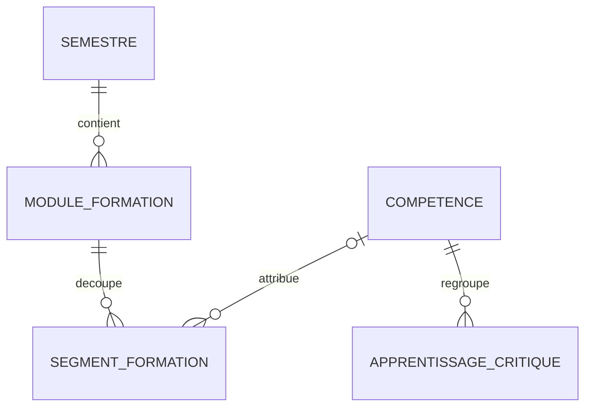
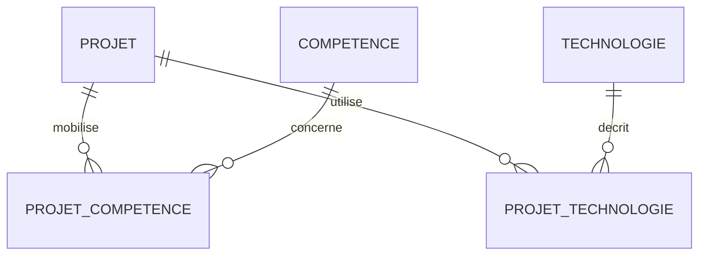
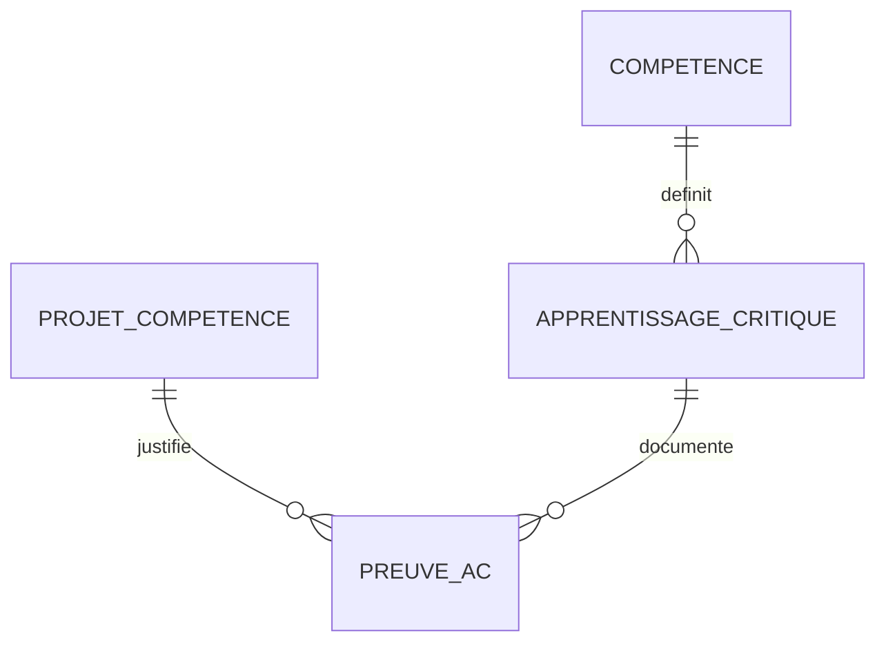

# Architecture et modèle relationnel

Proposition pour un portfolio individuel exécuté localement. Le langage serveur du cours reste à confirmer avant l’implémentation.

## Architecture

Le navigateur envoie une demande au serveur Flask. Une route appelle une fonction de lecture PostgreSQL, puis transmet les données au template HTML Jinja. CSS adapte la disposition ; JavaScript peut gérer les filtres et les graphiques. Le serveur porte les accès et identifiants de la base.

Séparer les routes, les requêtes et les templates. Utiliser des paramètres psycopg pour les valeurs des filtres ; valider les paramètres et ne jamais concaténer directement une saisie à la requête. Un endpoint JSON pourra être ajouté si les graphiques doivent se mettre à jour sans rechargement.

## Routes à implémenter

| Route | Page | Données principales |
| --- | --- | --- |
| `/` | Accueil | Statistiques, sélection de projets et présentation |
| `/projets` | Liste filtrable | Projets publiés, compétences et outils associés |
| `/projets/<slug>` | Détail | Contexte, contribution, résultat, preuves et outils |
| `/competences` | Compétences | C1–C4, heures renseignées, projets et AC |
| `/alternance` | Alternance | Missions, bilan et projets diffusables |

`est_public = false` exclut un projet de la liste publique, de son détail et des indicateurs publics. Le code des routes devra appliquer cette règle ; la colonne ne suffit pas à protéger les pages.

## Tables et responsabilités

| Table | Fonction | Relations |
| --- | --- | --- |
| `semestre` | Semestres 1–6, année déduite du numéro | Un semestre contient plusieurs modules et projets |
| `competence` | Intitulés C1–C4 | Liens vers AC, segments et projets |
| `apprentissage_critique` | Code, intitulé et source officielle d’un AC | Chaque AC appartient à une compétence |
| `module_formation` | Ressource/enseignement d’un semestre | Contient plusieurs segments horaires |
| `segment_formation` | Volume en minutes avec source | Un module, au plus une compétence ; non-affectation autorisée |
| `alternance` | Entreprise, poste, période, missions, bilan | Plusieurs projets pour une alternance |
| `projet` | Contenu et état de publication | Semestre principal, éventuelle alternance |
| `technologie` | Langage, outil ou logiciel | Partagée entre plusieurs projets |
| `projet_competence` | Compétences mobilisées | Association plusieurs-à-plusieurs |
| `projet_technologie` | Outils réellement utilisés et usage décrit | Association plusieurs-à-plusieurs |
| `preuve_ac` | Preuve d’un AC dans un projet | AC et compétence cohérents avec le projet |

## Formation et heures

Un segment est une tranche de formation non chevauchante. La somme des segments d’un module doit correspondre aux volumes documentés lorsque la saisie est complète. La base évite une affectation multiple au sein d’une ligne ; une saisie de deux lignes décrivant la même séance reste à détecter lors de l’import. La clé `(module_id, libelle)` rejette seulement les doublons portant le même libellé.

Si l’affectation à C1–C4 n’est pas connue, laisser `competence_code` vide et afficher le volume dans les heures non affectées. Ne pas convertir une relation à plusieurs compétences en quatre copies d’une durée.

## Projets, outils et compétences

Un projet peut mobiliser C1 et C2 et utiliser plusieurs outils. Les tables d’association évitent les colonnes répétées du type `outil1`, `outil2` et les listes séparées par des virgules. Une alternance peut porter plusieurs projets ; un projet d’origine `alternance` doit avoir une alternance associée.

## Apprentissages critiques et preuves

`projet_competence` indique une mobilisation. `preuve_ac` distingue `mobilise`, `en_cours` et `valide`. Une validation exige date, justification et type : autoévaluation ou évaluation pédagogique. Les compteurs séparent ces deux catégories ; une autoévaluation ne devient pas une validation pédagogique.

Les clés étrangères composites imposent que la compétence de la preuve corresponde à celle de l’AC et à une compétence associée au projet. Un AC démontré dans plusieurs projets compte une seule fois dans chaque compteur distinct. Un même AC peut apparaître dans les deux catégories si différentes preuves portent les deux types : ne pas additionner ces compteurs pour calculer un total d’AC distincts.

## Statistiques

Les vues de `03-statistiques.sql` agrègent les volumes indépendamment des relations entre projets, outils et preuves. Ainsi, ajouter un outil à un projet ne peut pas modifier les heures de formation.

Une somme sans segment retourne `NULL`. L’interface doit afficher « À renseigner ». Les compteurs correspondent aux enregistrements publiés dans cette base ; ils ne constituent pas les totaux officiels du diplôme. Afficher « données renseignées », les sources et les semestres couverts tant que la collecte est incomplète.

La couverture `nb_modules_avec_volume / nb_modules_renseignes` mesure seulement les modules déjà saisis : elle ne prouve pas que tout le programme a été importé. Un total officiel du BUT doit être vérifié séparément sur les documents pédagogiques.

## Première vérification dans PostgreSQL

1. Exécuter les trois scripts dans une base neuve avec arrêt sur erreur.
2. Vérifier quatre compétences et six semestres ; les autres tables sont vides.
3. Consulter les vues : heures inconnues, zéro projet publié enregistré.
4. Avec des données de test distinctes des données du portfolio, vérifier les contraintes de minute positive, semestre valide, doublon d’association et cohérence AC/compétence.
5. Saisir un module découpé en segments et vérifier que somme par compétence + non affectées = somme globale, avec valeurs absentes traitées comme zéro pour ce contrôle seulement.
6. Ajouter une technologie et une preuve sur un projet : la somme des heures doit rester identique.
7. Vérifier qu’un projet non publié n’apparaît pas dans les compteurs publics ni dans les futures routes.

Ces contrôles sont à réaliser sur un serveur PostgreSQL local. Les scripts du kit n’ont pas été exécutés sur un tel serveur dans l’environnement de préparation.

Sources : [Flask](https://flask.palletsprojects.com/en/stable/), [requêtes paramétrées psycopg](https://www.psycopg.org/psycopg3/docs/basic/params.html), [contraintes PostgreSQL](https://www.postgresql.org/docs/current/ddl-constraints.html).
