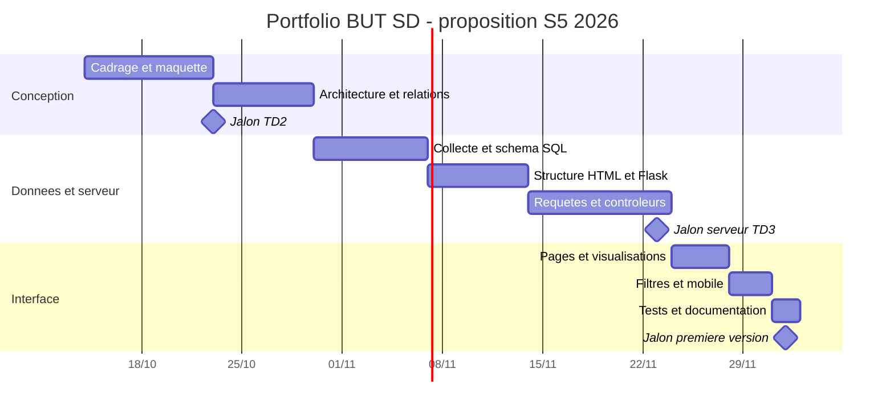

# Planning prévisionnel

Version initiale préparée le **14 octobre 2026**. L’année 2026 est une hypothèse pour les dates du semestre 5 : le texte fourni mentionne les jours/mois, sans année. Ce planning ne prouve pas qu’une tâche a été faite avant sa rédaction. Confirmer les dates auprès de l’enseignant ; le semestre 6 n’est pas daté.

## Séances et livrables proposés

| Séance donnée | Temps encadré | Livrable à viser | Dépendance | État du travail étudiant |
| --- | ---: | --- | --- | --- |
| TD1 — 06/10 | 2 h | Sujet, premier planning, maquette, dépôt initial | Cahier des charges | À confirmer |
| TD2 — 23/10 | 2 h | Architecture, navigation, schéma relationnel | Maquette et contraintes validées | À faire |
| TD3 — 23/11 | 4 h | Base, données et contrôleurs fonctionnels | Schéma et données sources | À faire |
| TD4 — 24/11 | 1 h 30 | Première visualisation reliée aux données | Requêtes correctes | À faire |
| Projet — 24/11 | 4 h | Pages projets/compétences/alternance | Serveur et premières vues | À faire |
| Projet — 30/11 | 2 h | Filtres, mobile et contrôles fonctionnels | Pages fonctionnelles | À faire |
| Projet — 02/12 | 3 h | Première version présentable et documentation | Tests et corrections | À faire |
| Semestre 6 — date inconnue | 6 h | Compléments, données finales, corrections et bilan | Première version | À planifier |
| Semestre 6 — date inconnue | 4 h | Préparation et présentation orale | Démonstration reproductible | À planifier |

**Total donné : 28 h 30 de séances de développement/gestion/préparation, plus 1 h 30 d’interrogations, soit 30 h.** Les interrogations sont annoncées le 24/11 (30 min) et le 02/12 (1 h). Ces temps concernent le module portfolio. Ils ne décrivent ni la charge de travail personnel ni le nombre d’heures de formation du BUT.

## Gantt proposé pour le semestre 5

Voir également le [Gantt en SVG](gantt.svg) et sa [version PNG](gantt.png), exportés à partir des dates du diagramme ci-dessous.

Les barres représentent des **fenêtres calendaires**, pas des journées complètes de travail. Réserver les séances et le travail personnel disponibles à l’intérieur de ces fenêtres. Les dates des jalons reprennent le calendrier joint ; les fenêtres entre jalons constituent une proposition d’organisation.

Le début de `a1` correspond à la préparation actuelle ; le TD1 du 06/10 reste documenté dans le tableau, avec un état à confirmer. Le Gantt ne représente pas les séances du semestre 6 : leurs dates seront ajoutées lorsqu’elles seront connues.

## Suivre le planning

Dans Projects, définir pour chaque tâche : état, début prévu, fin prévue, charge estimée en heures, temps passé, dépendance et commentaire. À la fin de chaque séance :

1. Déplacer les tâches réellement terminées et renseigner les contrôles effectués.
2. Faire un commit correspondant au travail accompli.
3. Mettre à jour `AVANCEMENT.md` et les tâches restantes.
4. Si une échéance change, conserver le motif et l’ancienne date dans le journal, puis modifier le Gantt et la Roadmap.

## Jalons d’acceptation

| Jalon | Condition pour le considérer terminé |
| --- | --- |
| Maquette | Sections et navigation représentées sur ordinateur et mobile ; choix expliqués |
| Architecture | Front, serveur, base, tables et relations documentés |
| Serveur | Lecture de vraies lignes PostgreSQL et affichage d’un projet |
| Visualisations | Valeurs égales aux requêtes SQL, inconnues identifiées |
| Première version | Pages utilisables sur mobile, filtres cohérents et README reproductible |
| Livraison | Données sourcées, bilan, historique réel et oral préparé |
